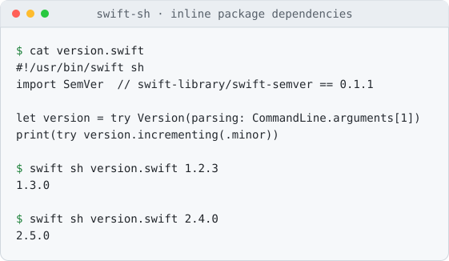

<div align="center">

<p align="center">
  <a href="https://github.com/swift-library/swift-sh"></a>
</p>

<h1 align="center">swift-sh</h1>

<p align="center">
  Run single-file Swift scripts with package dependencies declared inline.
</p>

<p align="center">
  <a href="https://github.com/swift-library/swift-sh/actions/workflows/ci.yml"></a>
  
  
  <a href="LICENSE.txt"></a>
</p>

<p align="center">
  <a href="#overview">Overview</a> ·
  <a href="#quick-look">Quick look</a> ·
  <a href="#install">Install</a> ·
  <a href="#usage">Usage</a> ·
  <a href="#requirements">Requirements</a> ·
  <a href="#documentation">Documentation</a> ·
  <a href="#contributing">Contributing</a> ·
  <a href="#license">License</a>
</p>

</div>

## Overview

Keep a script in one file, with no `Package.swift` to maintain. A trailing import comment names a dependency; `swift sh` builds the generated package in a cache and forwards your arguments. See [dependency comments](Documentation/Reference/DependencyComments.md) and the [command reference](Documentation/Reference/Commands.md) for syntax and execution rules.

## Quick look

An import comment supplies SemVer; the script increments the version you pass.

<p align="center">
  <picture>
    <source media="(prefers-color-scheme: dark)" srcset="Documentation/Assets/Demo-dark.svg">
    <source media="(prefers-color-scheme: light)" srcset="Documentation/Assets/Demo-light.svg">
    
  </picture>
</p>

## Install

Install with Homebrew from the swift-library tap:

```bash
brew install swift-library/tap/swift-sh
```

The formula builds swift-sh from its release source, so Swift 6.3 or later
must be on `PATH`. On macOS, select Xcode 26 or later with `xcode-select`.

To build from source instead:

```bash
git clone --branch v0.2.0 https://github.com/swift-library/swift-sh.git
cd swift-sh
swift build -c release --force-resolved-versions
```

Copy `.build/release/swift-sh` to a directory on your `PATH`, then check the
installation with `swift sh --version`.

> [!NOTE]
> swift-sh is pre-1.0. Minor releases may include breaking changes to its
> commands and dependency comment syntax.

## Usage

Save a Swift file with a package comment after each dependency import, then run
`swift sh version.swift 1.2.3`. Arguments after the file path go to the script;
standard streams, working directory, and exit status are preserved.

The [dependency reference](Documentation/Reference/DependencyComments.md)
covers repository forms, version constraints, and import discovery. The
[command reference](Documentation/Reference/Commands.md) covers standard input,
debug builds, packaging, editing, caching, and execution limits.

## Requirements

- Swift 6.3 or later on `PATH`, for both swift-sh and the scripts it builds
- macOS 15 or later, or Linux with a supported Swift toolchain
- On macOS, building swift-sh requires the macOS SDK from Xcode 26 or later

Each release supports the three most recent major macOS versions, currently
macOS 15, 26, and 27. CI tests macOS 15 and 26, and Linux with the Swift 6.3.3
Ubuntu 22.04 container on Ubuntu 24.04 runners. The
[versioning and release policy](Documentation/Architecture/VersioningAndRelease.md)
describes compatibility and maintenance.

## Documentation

- [Command reference](Documentation/Reference/Commands.md): input handling,
  packaging, editing, the cache, path rules, and exit codes.
- [Dependency comments](Documentation/Reference/DependencyComments.md):
  every repository form, version constraint, and conditional compilation rule.
- [Runtime architecture](Documentation/Architecture/RuntimeArchitecture.md):
  script analysis, generated packages, caching, and execution.
- Example scripts: [terminal colors](Examples/terminal-rainbow),
  [Swift Markdown](Examples/markdown), and an
  [async entry point](Examples/async-main-count-lines).
- [Changelog](CHANGELOG.md)

## Contributing

Read [CONTRIBUTING.md](CONTRIBUTING.md) before opening a pull request, and run
`Scripts/check` before submitting changes. Report vulnerabilities through the
private route in [SECURITY.md](SECURITY.md).

## License

swift-sh is available under the Apache License 2.0 with the Swift Runtime
Library Exception. See [LICENSE.txt](LICENSE.txt) and [NOTICE](NOTICE), which
also lists the licenses of the dependencies built into the executable.
Releases 0.1.0 and 0.1.1 were published under the Unlicense.
